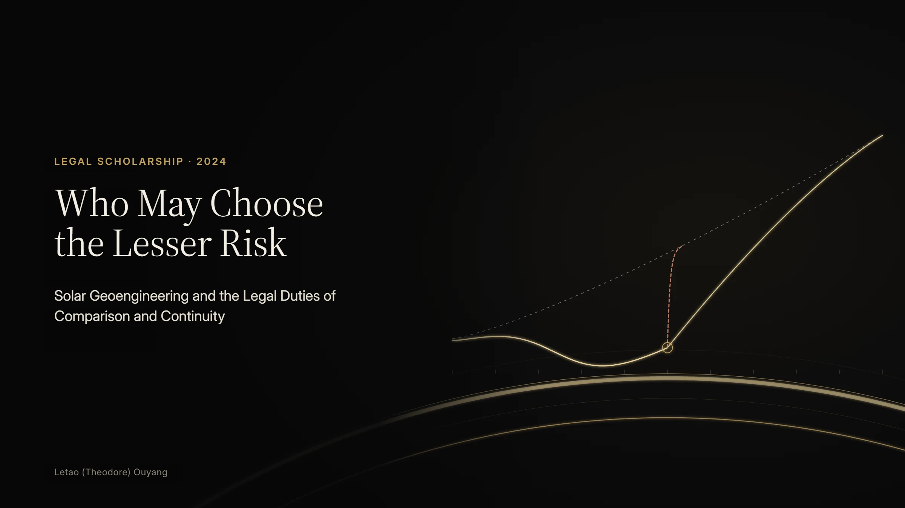
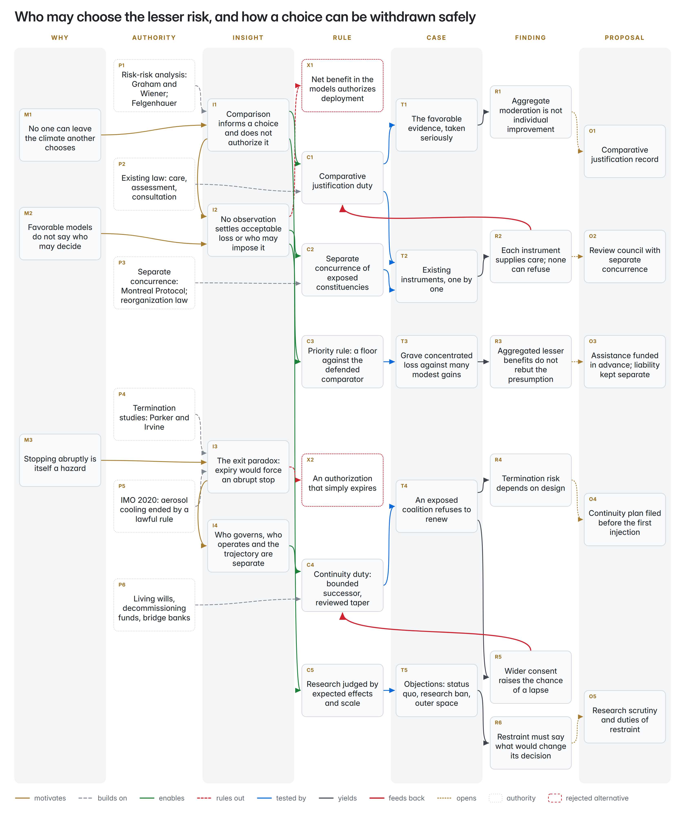

# Who May Choose the Lesser Risk: Solar Geoengineering and the Legal Duties of Comparison and Continuity

**Letao (Theodore) Ouyang** · Duke Law School · December 2024; revised November 2026

[Article](manuscript/who-may-choose-the-lesser-risk.md) · [PDF](paper/paper.pdf) · [Argument map](docs/argument-map.md) · [Proposal](docs/proposal.md) · [Research route](docs/research-route.md) · [Literature](docs/literature.md)

**Who may choose among climate risks for people who cannot escape the resulting climate, and how can that choice be withdrawn without catastrophe?**

Stratospheric aerosol injection poses a problem that identifying competing risks cannot resolve. This Article
argues that risk-risk analysis should support a comparative justification duty, and not operate as a substitute
for authorization: a deployment proponent defends its policy comparator, exposes its distributional assumptions to
challenge, and establishes responsibility for both continued operation and eventual withdrawal. The Article also
develops a continuity duty. Periodic authorization must let political control change without automatically
requiring abrupt physical cessation, and the law already has arrangements for systems that cannot safely stop:
resolution plans, decommissioning assurance, regulated abandonment and bridge institutions. The first duty assigns
the authority to decide. The second makes a withdrawal of consent something an institution can survive.

## Three claims to start with

| Claim | Why it matters | Where |
| --- | --- | --- |
| **Comparison informs a choice and does not authorize it.** Even favorable simulations cannot settle the welfare metric, the acceptable inequality or the allocation of authority through which their results acquire policy significance | The argument holds whether or not solar geoengineering creates geographical losers. The proponent owes a justification that those exposed can challenge with consequence | [Parts II, III, V](manuscript/who-may-choose-the-lesser-risk.md) · [Argument map](docs/argument-map.md#part-v-a-comparative-justification-duty) |
| **Existing law supplies care, assessment and consultation, and no authority able to refuse.** Under the International Law Commission's prevention articles, the state of origin may still authorize when consultations fail | The Article states exactly where its proposal departs from existing law, and gives the device that fills the gap: separate concurrence, as in the Montreal Protocol's financial mechanism and in reorganization law | [Part IV](manuscript/who-may-choose-the-lesser-risk.md) · [Proposal](docs/proposal.md#2-review-and-challenge) |
| **The exit paradox, and the continuity duty that dissolves it.** After sustained cooling, the expiry of an authorization would force the most dangerous act. Separating who governs, who operates and what trajectory follows lets a refusal change the operator and start a reviewed taper | Broad political control and physical continuity become compatible. Each element of the duty has a counterpart in law that already governs systems that cannot safely stop | [Part VI](manuscript/who-may-choose-the-lesser-risk.md) · [Proposal](docs/proposal.md#4-continuity-plan) |

## The problem

Stratospheric aerosol injection could moderate some climate hazards and would do so for everyone at once. The
people affected cannot leave the resulting climate, and a program that has run for years cannot be stopped
abruptly without returning the suppressed warming quickly. Risk-risk analysis identifies what a comparison must
include: magnitude, uncertainty, timing, distribution and alternatives. It does not say who decides. And a
periodic authorization, the usual instrument of conditional permission, turns against itself here, because its
lapse would require the abrupt cessation that everyone agrees is the worst outcome. In 2020 a lawful limit on
sulfur in marine fuel ended an aerosol cooling influence in just that way.

## The argument in brief

1. **What risk-risk analysis can establish** (Part II). Its categories organize the inquiry and cannot fix the
   unit of concern. Two of them are already positive law, in article 195 of the Law of the Sea Convention, which
   still does not say who decides whether a transfer is justified.
2. **Comparing without choosing the answer in advance** (Part III). Three baselines kept apart, a two-stage
   analysis, feasibility that stays contestable, and favorable evidence taken seriously for what it shows.
3. **Research permission and the limits of existing law** (Part IV). The Vienna Convention, the Framework
   Convention, the International Law Commission's guidelines on the atmosphere and the decisions of the
   International Court of Justice each supply a duty of care or assessment. None supplies an authority to refuse.
4. **A comparative justification duty** (Part V). Who must justify what, how challenge is made consequential
   through separate concurrence, how responsibility is funded before attribution is possible, and a priority rule
   against grave, concentrated harm.
5. **The problem of exit** (Part VI). The exit paradox, the precedent of 2020, and the continuity duty with its
   four domestic counterparts.
6. **Objections** (Part VII). That restraint privileges a damaging status quo, that research itself should be
   barred, and that the argument transfers to outer space.

## What the Article contributes

1. **The comparative justification duty.** Risk-risk analysis turned from a method into an obligation owed by a
   proponent, with a defended comparator and disclosed weights.
2. **Separate concurrence of exposed constituencies, with its precedents.** The Montreal Protocol counts a
   majority within each group of parties; reorganization law counts acceptance class by class and guarantees each
   dissenter a floor. A supermajority restrains the eager actor. Separate concurrence adds that the majority
   includes those who would bear the exposure.
3. **A priority rule built as a floor.** A strong presumption against grave, concentrated increases in harm
   relative to an available alternative, which aggregated lesser benefits do not rebut.
4. **The exit paradox and the continuity duty.** A pre-designated, bounded successor and a reviewed taper, as
   conditions of authorization.
5. **Four domestic counterparts for continuity.** A resolution plan filed in advance, decommissioning funds
   assured before they are needed, abandonment only by permission, and a bridge institution with a bounded term.
   A deployment program should file the equivalent of a living will before its first injection.
6. **The reconciliation of the two duties.** Wider consent raises the chance of a lapse. Under the continuity duty
   a lapse changes who operates.

[Where this Article sits](docs/literature.md) sets these against risk-risk analysis, the literature on termination
and the debate over democratic control, and the [bibliography](docs/bibliography.md) lists all 211 authorities and
sources.

## The proposal

Before deployment, a comparative justification record: the specified intervention, three comparators, a two-stage
analysis, disaggregated exposures, the strongest objections and the answers to them, and funded responsibility. A
review council with an independent science panel, in which exposed constituencies can withhold approval. A
priority rule. A continuity plan filed before the first injection. Scrutiny of research by expected effects and
cumulative scale, and duties on institutions that maintain restraint. The [proposal](docs/proposal.md) sets each
out as the record a review institution would require.

## How the argument was built

<picture>
  <source media="(prefers-color-scheme: dark)" srcset="assets/route-dark.png">
  
</picture>

The route is a network. The two duties were worked out against each other, and two findings went back and changed
a rule.

- **Who may choose.** Comparison does not authorize, and no observation settles acceptable loss, which rules out
  reading modeled net benefit as permission.
- **Testing the first duty.** Existing law supplies care and no power to refuse. The duty is drawn at exactly that
  point.
- **How a choice is withdrawn.** Wider consent makes a lapse likelier, so the successor and the taper became
  conditions of authorization.

The [research route](docs/research-route.md) explains all 36 steps and all 37 links.

## Repository

| Path | Contents |
| --- | --- |
| [`manuscript/`](manuscript/who-may-choose-the-lesser-risk.md) | The Article, with its notes |
| [`paper/paper.pdf`](paper/paper.pdf) | The Article as a PDF |
| [`docs/argument-map.md`](docs/argument-map.md) | Each claim, the authority it rests on, the strongest objection and the response |
| [`docs/proposal.md`](docs/proposal.md) | The justification record, the review design, the priority rule and the continuity plan |
| [`docs/research-route.md`](docs/research-route.md) | The logic of the Article as a network, node by node |
| [`docs/literature.md`](docs/literature.md) · [`docs/bibliography.md`](docs/bibliography.md) | Where the Article sits, and the 211 authorities and sources |

## Citation

Letao (Theodore) Ouyang, *Who May Choose the Lesser Risk: Solar Geoengineering and the Legal Duties of Comparison and
Continuity* (Duke Law School, 2024), <https://www.theodoreoy.com/experience/who-may-choose-the-lesser-risk/>. See
[CITATION.cff](CITATION.cff).

[theodore.oy2025@gmail.com](mailto:theodore.oy2025@gmail.com) · [10@alumni.duke.edu](mailto:10@alumni.duke.edu)

© Letao (Theodore) Ouyang. All rights reserved.
