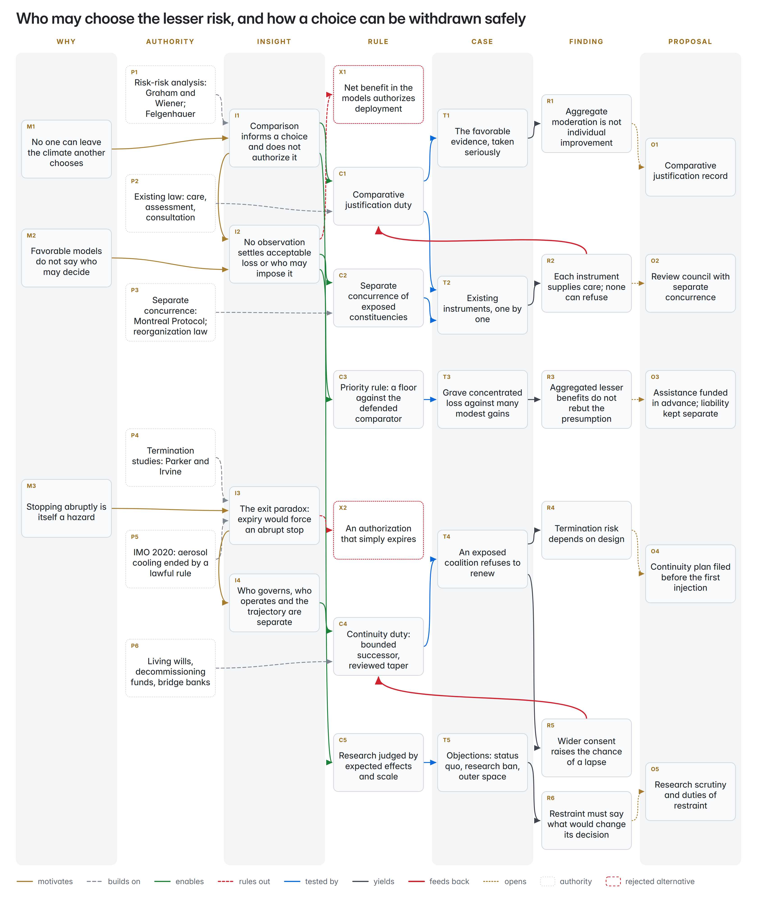

# Research route

How the argument was built: which body of authority supports which step, where a finding went back and changed a
rule, and what the rules become as instruments. The Article does not run from problem to solution in one line. The
two duties were worked out against each other, because the first widens who may refuse and the second has to make
a refusal safe.

<picture>
  <source media="(prefers-color-scheme: dark)" srcset="../assets/route-dark.png">
  
</picture>

## Reading the figure

Columns are kinds of step, not stages in time. A link can run between any two columns, and two run backwards, from
a finding to a rule.

| Link | Meaning |
| --- | --- |
| motivates | A problem or an insight that made the next step necessary |
| builds on | An authority the step rests on |
| enables | A step that makes another one possible |
| tested by / yields | A rule and the case that tests it; a case and what it shows |
| feeds back | A finding that changed a rule |
| rules out | A step that excludes an alternative |
| opens | A finding that becomes an instrument |

Solid boxes are the Article's own steps. Dotted boxes are authority, and red dashed boxes are positions the Article
rejects.

## The three threads

### 1. Who may choose

M1, M2 → I1 → I2 → C1, C2, C3, with I2 ruling out X1.

Stratospheric aerosol injection changes the climate for people who cannot leave it (M1). Risk-risk analysis lists
what a comparison must include (P1) and leaves the authority to decide unassigned: comparison informs a choice and
does not authorize it (I1). The argument has to hold even when the models are favorable (M2), and it does, because
no observation settles what loss is acceptable or who may impose it (I2). That rules out reading modeled net
benefit as authorization (X1).

Three rules follow. A proponent owes a comparative justification (C1): it defends its comparator, exposes its
distributional assumptions and answers the strongest objections. Those exposed can collectively withhold approval
through separate concurrence (C2), a device with working precedents in the Montreal Protocol and in reorganization
law (P3). And a priority rule sets a floor against the defended comparator (C3), which aggregated lesser benefits
do not override.

### 2. Testing the first duty

C1, C2, C3 → T1, T2, T3 → R1, R2, R3, with R2 feeding back into C1.

Taken seriously, the favorable evidence shows that aggregate moderation is not individual improvement (T1, R1).
Read one by one, the existing instruments each supply care, assessment or consultation, and none supplies an
authority able to refuse (T2, R2): under the International Law Commission's prevention articles the state of
origin may still authorize when consultations fail. That finding went back into the duty (R2 → C1), which is drawn
at exactly the point where existing law stops. The hard distributional case, a grave and concentrated loss against
many modest gains (T3), fixes what rebuts the presumption and what does not (R3).

### 3. How a choice is withdrawn

M3 → I3 → I4 → C4 → T4 → R4, R5, with I3 ruling out X2 and R5 feeding back into C4.

Stopping abruptly is itself a hazard (M3). Periodic authorization keeps permission conditional, and after
sustained cooling its expiry would force the most dangerous act: this is the exit paradox (I3). It has occurred in
kind, when a lawful limit on sulfur in marine fuel ended an aerosol cooling influence abruptly (P5). An
authorization that simply expires is therefore ruled out (X2). The paradox dissolves once three decisions are
separated: who governs, who operates and what trajectory the intervention follows (I4). The continuity duty (C4)
requires a bounded successor and a reviewed taper, and each of its elements has a counterpart in law that already
governs systems that cannot safely stop (P6).

The test is an exposed coalition that refuses to renew (T4). Termination risk depends on design (R4), and wider
consent raises the chance that an authorization lapses (R5). That second finding went back into the rule
(R5 → C4): because separate concurrence makes lapse likelier, the successor and the taper are conditions of
authorization and not later additions. Broad political control and physical continuity are compatible because a
bounded successor stands between them.

Research is judged by the same comparison, by expected effects and cumulative scale (C5), and the objections from
both sides (T5) yield the duty that restraint owes in return: to say what would change its decision (R6).

## From findings to instruments

| Instrument | Comes from | What it does |
| --- | --- | --- |
| O1 Comparative justification record | R1 | Three comparators, a two-stage analysis, disaggregated exposures and answers to objections ([records](proposal.md)) |
| O2 Review council with separate concurrence | R2 | An institution with the power existing law lacks |
| O3 Assistance funded in advance | R3 | Monitoring, adaptation, emergency response and claims are financed before deployment, with liability kept separate |
| O4 Continuity plan | R4 | Filed before the first injection: successor, redundancy, finance and taper |
| O5 Research scrutiny and duties of restraint | R6 | Classification by expected effects, and periodic review of the reasons for restraint |

## Every node

| Node | Column | What it is |
| --- | --- | --- |
| **M1** No one can leave the climate another chooses | Why | Stratospheric aerosol injection changes the climate for people who cannot escape the result. |
| **M2** Favorable models do not say who may decide | Why | Even favorable simulations leave open the welfare metric, the acceptable inequality and the allocation of authority. |
| **M3** Stopping abruptly is itself a hazard | Why | After sustained cooling an abrupt end returns the suppressed warming quickly. |
| **P1** Risk-risk analysis: Graham and Wiener; Felgenhauer | Authority | Countervailing risks, their distribution and the alternatives a decision must compare. |
| **P2** Existing law: care, assessment, consultation | Authority | The Vienna Convention, the Framework Convention, the ILC guidelines and prevention articles, Pulp Mills and Certain Activities. |
| **P3** Separate concurrence: Montreal Protocol; reorganization law | Authority | A majority that must include a majority of each group, and a floor that the majority cannot vote away. |
| **P4** Termination studies: Parker and Irvine | Authority | The danger of stopping depends on design and on capable states standing ready to continue. |
| **P5** IMO 2020: aerosol cooling ended by a lawful rule | Authority | The sulfur limit for marine fuel, analyzed as an inadvertent termination of aerosol cooling. |
| **P6** Living wills, decommissioning funds, bridge banks | Authority | 12 U.S.C. § 5365(d)(1), 10 C.F.R. § 50.75(a), 15 U.S.C. § 717f(b) and 12 U.S.C. § 1821(n). |
| **I1** Comparison informs a choice and does not authorize it | Insight | Risk-risk analysis identifies what a comparison must include and leaves the authority to decide unassigned. |
| **I2** No observation settles acceptable loss or who may impose it | Insight | Model results acquire policy significance only through welfare metrics and distributional choices that evidence cannot supply. |
| **I3** The exit paradox: expiry would force an abrupt stop | Insight | Periodic authorization keeps permission conditional, and after sustained cooling its expiry would require the most dangerous act. |
| **I4** Who governs, who operates and the trajectory are separate | Insight | Political control can change while operation passes to a bounded successor and the trajectory tapers. |
| **X1** Net benefit in the models authorizes deployment | Rule | Rejected: aggregate benefit does not decide a conflict over subsistence or survival, or who may impose it. |
| **C1** Comparative justification duty | Rule | A proponent defends its comparator, exposes its distributional assumptions to challenge and answers the strongest objections. |
| **C2** Separate concurrence of exposed constituencies | Rule | Exposed representatives who are not sponsors can collectively withhold approval or require redesign. |
| **C3** Priority rule: a floor against the defended comparator | Rule | A strong presumption against grave, concentrated increases in harm relative to an available alternative. |
| **X2** An authorization that simply expires | Rule | Rejected: if lapse meant cessation, broader legitimacy would be bought with greater physical danger. |
| **C4** Continuity duty: bounded successor, reviewed taper | Rule | A transition authority agreed before deployment, operational redundancy, transition finance and a tapering pathway. |
| **C5** Research judged by expected effects and scale | Rule | Inquiry is permitted when its informational value, alternatives and direct effects withstand review. |
| **T1** The favorable evidence, taken seriously | Case | Irvine and Keith on climate hazards, Proctor et al. and Fan et al. on crop yields, and the WMO ozone assessment. |
| **T2** Existing instruments, one by one | Case | The Paris Agreement, CBD Decision X/33, the Vienna Convention, the Framework Convention, the ILC texts and the ICJ's decisions. |
| **T3** Grave concentrated loss against many modest gains | Case | A group made worse off than under an available alternative while aggregate measures improve. |
| **T4** An exposed coalition refuses to renew | Case | Approval is withdrawn after years of sustained cooling. |
| **T5** Objections: status quo, research ban, outer space | Case | That restraint privileges a damaging status quo, that research itself should be barred, and that the argument transfers to outer space. |
| **R1** Aggregate moderation is not individual improvement | Finding | Favorable evidence is real and limited: yields are not food access, and a regional mean is not a livelihood. |
| **R2** Each instrument supplies care; none can refuse | Finding | Under the prevention articles the state of origin may still authorize when consultations fail. |
| **R3** Aggregated lesser benefits do not rebut the presumption | Finding | The presumption yields only to comparably grave threats averted, with no less harmful portfolio and with shared authorization and relief. |
| **R4** Termination risk depends on design | Finding | Gradual withdrawal, limited cooling and redundancy change the risk. |
| **R5** Wider consent raises the chance of a lapse | Finding | Separate concurrence adds parties who may refuse, so legitimacy and continuity pull apart unless a successor stands between them. |
| **R6** Restraint must say what would change its decision | Finding | Institutions that maintain a moratorium assess forgone benefits and review on schedule. |
| **O1** Comparative justification record | Proposal | The specified intervention, three comparators, a two-stage analysis, disaggregated exposures, and answers to objections. |
| **O2** Review council with separate concurrence | Proposal | An independent science panel, a council that decides, and exposed-constituency representatives who can withhold approval. |
| **O3** Assistance funded in advance; liability kept separate | Proposal | Monitoring, adaptation, emergency response and claims are financed before deployment. |
| **O4** Continuity plan filed before the first injection | Proposal | The equivalent of a living will: successor, redundancy, finance and taper. |
| **O5** Research scrutiny and duties of restraint | Proposal | Classification by expected effects and cumulative scale, and periodic review of the reasons for restraint. |

## Every link

| # | From | To | Link | Why |
| ---: | --- | --- | --- | --- |
| 1 | M1 | I1 | motivates | A choice made for people who cannot exit needs an authority, not only an analysis |
| 2 | P1 | I1 | builds on | The method that lists what a comparison includes |
| 3 | M2 | I2 | motivates | The argument has to hold even when the models are favorable |
| 4 | I1 | I2 | motivates | If analysis does not authorize, what remains open has to be named |
| 5 | I2 | X1 | rules out | A model result does not carry its own welfare metric or its own authority |
| 6 | I1 | C1 | enables | The proponent owes a justification against a defended comparator |
| 7 | P2 | C1 | builds on | Assessment and consultation, extended to a duty that can be refused |
| 8 | I2 | C2 | enables | Those represented in a model need a route to challenge it with consequence |
| 9 | P3 | C2 | builds on | Consent counted separately where the stakes differ |
| 10 | I2 | C3 | enables | Many modest benefits must not silently settle a conflict over subsistence |
| 11 | I1 | C5 | enables | The same comparison disciplines research by what it would do |
| 12 | M3 | I3 | motivates | A permission that can lapse meets a system that cannot stop |
| 13 | P4 | I3 | builds on | What makes termination dangerous or safe |
| 14 | P5 | I3 | builds on | An abrupt lawful termination has already occurred |
| 15 | I3 | X2 | rules out | Expiry cannot be allowed to mean cessation |
| 16 | I3 | I4 | motivates | The paradox dissolves when three decisions are separated |
| 17 | I4 | C4 | enables | A refusal changes who operates and starts a taper |
| 18 | P6 | C4 | builds on | Instruments the law already uses for systems that cannot safely stop |
| 19 | C1 | T1 | tested by | Whether favorable evidence satisfies the duty by itself |
| 20 | C1 | T2 | tested by | Whether existing law already imposes it |
| 21 | C2 | T2 | tested by | Whether any existing instrument lets the exposed refuse |
| 22 | C3 | T3 | tested by | The hard distributional case |
| 23 | C4 | T4 | tested by | A withdrawal of consent after sustained cooling |
| 24 | C5 | T5 | tested by | The objections from both sides |
| 25 | T1 | R1 | yields | What favorable evidence establishes |
| 26 | T2 | R2 | yields | Where existing law stops |
| 27 | T3 | R3 | yields | What rebuts the presumption and what does not |
| 28 | T4 | R4 | yields | The conditions under which stopping is safe |
| 29 | T4 | R5 | yields | The tension between consent and continuity |
| 30 | T5 | R6 | yields | What restraint owes in return |
| 31 | R2 | C1 | feeds back | The duty is drawn at the point where existing law stops: the proponent may not simply authorize itself |
| 32 | R5 | C4 | feeds back | Because wider consent makes lapse likelier, the successor and the taper are conditions of authorization |
| 33 | R1 | O1 | opens | The record disaggregates what the aggregate hides |
| 34 | R2 | O2 | opens | An institution with the power existing law lacks |
| 35 | R3 | O3 | opens | Relief is secured before the burden is imposed |
| 36 | R4 | O4 | opens | The safe design is written down before operation |
| 37 | R6 | O5 | opens | Restraint is reviewed like deployment |
